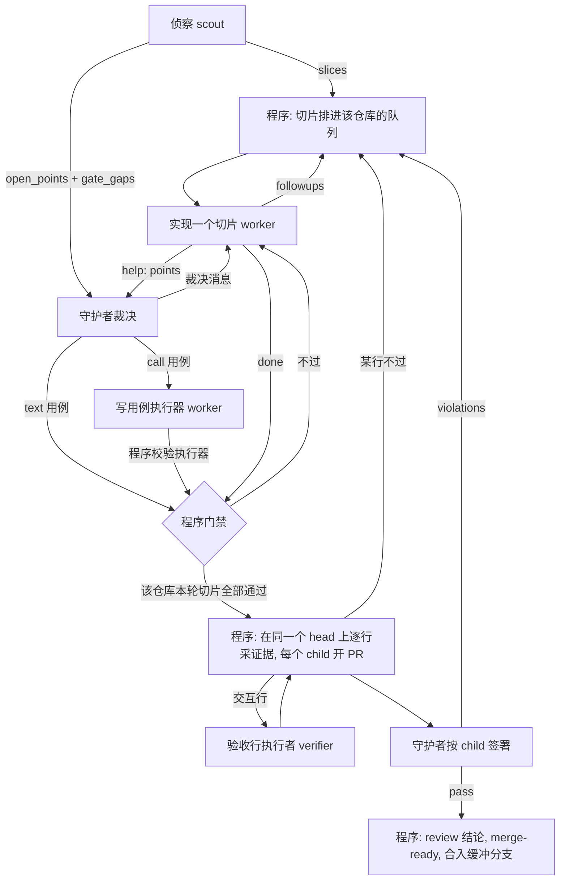

# 低成本模型交付 #320 / #321 / #322 的编排方案

依据：omp-config#323 上的两轮试跑（会话记录、`.tmp/lowcost/runs/`、`.tmp/lowcost/v2/p323/`）、自写的确定性探针（`.tmp/lowcost/eval/battery.ts`）、28 个 issue 正文的验收表解析（`.tmp/lowcost/catalog.js` 生成 `catalog.json`）和 25 个 child 的侦察结果（`.tmp/lowcost/scouts/`）。费用是会话记录里的标价。验收行按「本机 / 沙箱」「单条命令 / 散文步骤」的归类来自关键字和单元格形状，个别行可能归错。

## 1. 结论

- 一个 issue 不交给任何单个 agent。流程拆成侦察、裁决、写用例执行器、实现切片、执行验收行、签署这些小任务，门禁、集成、采证据和开 PR 由程序做；每个任务的返回值由程序展开成后续任务。
- 正确性只由运行时行为判定：门禁是程序在提交上执行的命令；守护者的裁决以「输入 → 期望输出」用例的形式并入门禁。没有审查循环，没有投票。
- 每个 issue 一名守护者（Sonnet），一个会话贯穿始终：开工前一次裁完开放点，结束时对照 issue 的目标签一次。裁错由最终验收兜底。
- 实现者主力是 Haiku。SWE-2 质量相同且免费，但有并发限流，只开一个并发位，失败就把切片转给 Haiku。DeepSeek 不做实现，只做侦察和验收行执行。
- 验收表共 174 行。109 行的 Command 是写死的命令（或引用前一行的命令），由程序经 `ghc ev run` 执行；65 行是散文步骤（「起会话，输入某句话」「按某 issue 第 N 行执行」），三个总体验收 issue 的 24 行全部属于这一类。其中 63 行交给验收行执行者把它变成命令并驱动终端，2 行（Windows 真机、Tern 窗口）由主会话做。执行者在一条本机散文行上读数全对；驱动终端和沙箱的那一半还没有测到，是本方案最大的未知。
- 174 行里 83 行要沙箱。本机 Docker 地址池现在是满的，一行沙箱行都跑不了；不依赖沙箱就能交付的 child 只有 6 个。

## 2. 两轮试跑的数据

### 第一轮：一个 worker 拿整个 issue，审查者逐条检查，裁决者按需介入

| 克隆 | worker | 轮数 | 审查轮数 | 审查花费 | 裁决花费 | 结局 |
|---|---|---|---|---|---|---|
| low | Haiku $0.21 | 2 | 1（DeepSeek 审） | $0.04 | $0.32 | 通过 |
| free1 | SWE-2 $0.43 | 5 | 4（Haiku 审） | $0.49 | $0.55 | 第 4 轮仍不过 |
| mid | DeepSeek $0.11 | 5 | 3（Haiku 审） | $0.62 | $0.43 | 第 3 轮仍不过 |

- 「代码不得自行决定开放点」这条检查不收敛：每轮审查都能再找出一个新角落，最后两个是没有任何生产者会发出的构造输入。
- 两个裁决者对同一问题（旧形状带 `timedOut`）裁出相反结论。
- 审查找到的三个真缺陷（纯空白答案、多行答案、类型链接漏洞）都能写成运行时用例；探针 5 秒测出全部三个。
- 内置 `task:*` 定义让 SWE-2 和 DeepSeek 各派了一次 mentor 子代理，是编排之外的开销。
- low 那一行只审了一轮、审查者不同、当时也没有那条不收敛的检查，和另两行不可直接比。

### 第二轮（v2）：侦察 → 一次裁决 → 切片实现 → 程序门禁 → 一次签署

三个实现者拿到同一份侦察结果和同一批裁决：

| 实现者 | 轮数 | 求助 | 门禁 | 请求数 | 标价 | 用时 | 探针：明文行为 / 措辞隐含 / 类型变更 |
|---|---|---|---|---|---|---|---|
| Haiku | 1 | 0 | 首次通过 | 16 | $0.12 | 169 s | 19/19、3/3、4/8 |
| SWE-2 | 1 | 0 | 首次通过 | 32 | $0.22（免费额度） | 289 s | 同上 |
| DeepSeek | 1 | 0 | 首次通过 | 48 | $0.05 | 381 s | 同上 |

- 三者产出相同。第一轮的差距来自开放点没先裁、隐含行为没有门禁，不是模型能力。
- 类型变更 8 项只拦住 4 项，因为门禁只要求了 3 种改名：门禁量什么，产出就保证什么。
- DeepSeek 第一次运行列出同级目录并读了别的克隆里现成的答案，被终止后在隔离目录重跑；第一轮它还三次改 `node_modules`。
- #323 整条流程（Haiku 实现）：侦察 $0.04 + 守护者 $0.49（一次裁决、两次签署）+ 实现 $0.12 = $0.65。守护者占四分之三。

### 侦察角色：同一份 #323 合同

| 模型 | 切片 | 两个真实开放点 | 其他开放点 | 门禁缺口 | 标价 |
|---|---|---|---|---|---|
| SWE-2 | 1 个，把被 git 忽略的 `bun.lock` 列进可改文件 | 都找到 | 无 | 5 | $0.22 |
| Haiku | 2 个，其中「刷新 `bun.lock`」无法提交 | 都找到 | 2 个，标了无生产者 | 11 | $0.12 |
| DeepSeek | 1 个，正确 | 都找到 | 1 个，有生产者 | 5 | $0.04 |

DeepSeek 用宿主的表单解析器实际跑了输入来确认生产者。

### 验收行执行者

`loop:verifier`（DeepSeek）跑了两行：

| 行 | 结果 | 核对 | 标价 |
|---|---|---|---|
| #337 第 5 行（沙箱交互） | 第一步建沙箱失败，按 blocked 交回，没有动别人的网络 | Docker 的 30 个 IPv4 地址池被占满，其中 18 个是无容器的 `cua-t-*` 网络；我重试建网络得到同一个错误 | $0.02 |
| #337 第 9 行（本机散文步骤：照 5 个 issue 正文落 7 个固定脚本，按占位符拼出 8 条命令各跑一次） | 判 fail，1 条 exit 0、7 条 exit 1 | 7 个脚本与我独立抽取的逐字节相同；8 个退出码和输出与我自己跑的一致 | $0.017，22 次请求，87 秒 |

- 第 9 行的检出是 #323 的 PR head 加两个插件的 main，所以只有 #323 的驱动通过，其余 7 个在未实现的基准上失败：这同时证实这些驱动在基准上是红的。它没有重试，也没有为了通过去改命令，并在偏差里指出检出不是缓冲分支的 head。
- 它多做了几次只读排查（`git log`、`grep`），没有改任何文件。
- 驱动终端和沙箱的能力仍然没有测到。

## 3. 流程

| 任务 | 执行者 | 输入 | 返回值 | 程序如何展开 |
|---|---|---|---|---|
| 侦察 | `loop:scout` | 合同、基准检出 | `slices[]`、`open_points[]`、`gate_gaps[]` | 丢掉被 git 忽略的文件和空切片；开放点与缺口合并成一次裁决请求；切片按依赖排队 |
| 裁决 | `loop:guardian` | 开放点、门禁缺口、用例格式 | `rulings[]`，每条含 `outcome`（合同已定 / 新规则 / 无生产者不裁）和 `cases[]` | 用例写入门禁；裁决写进后续实现任务书 |
| 写用例执行器 | `loop:worker`，不是该 issue 的实现者 | 裁决里的 `call` 用例、被测模块的路径、用例文件格式 | 程序目录下的一个脚本：读用例文件，对检出里的真实模块逐条求值，逐条打印读数 | 程序校验后才并入门禁：同一提交跑两次读数相同；把每条用例的期望值改错后必须逐条失败 |
| 实现 | `loop:worker`（或 `loop:worker-free`） | 一个切片、可改文件、已有裁决、门禁工具 | `done`（`head`、`decisions`、`followups`、`deviations`、`risks`）、`help`（`points`）或 `blocked` | `done` 时只认门禁工具在该提交上的通过记录；`followups` 变成新切片；`help` 变成裁决请求再回到同一会话 |
| 门禁 | 程序 | 提交 | 每个门禁的通过与失败输出 | 不过则把失败输出发回同一 worker，最多 3 次，之后换一个新会话 |
| 验收 | 程序，交互行由 `loop:verifier` | 该仓库本轮的 head、每个 child 的验收表 | 每行的证据记录 | 纯命令行直接 `ghc ev run`；交互行每行派一名执行者；不过的行连同输出变成一个修复切片 |
| 签署 | `loop:guardian`（该 child 的同一会话） | 该 child 的切片 diff、证据包、裁决、worker 的自主决定 | `verdict`、逐条结果、`violations[]` | 通过则发 review 结论并查 `merge-ready`；不过则每条违例变成一个修复切片 |

- 每个切片一个新的 worker 会话，任务书里带上之前切片的裁决；没有会话累积整个 issue。
- 守护者的请求串行：同一会话同一时间只答一个。
- 裁决的用例分三种。`text`：某个文件必须含有或不得含有一段字面文本，程序自带执行器。`call`：对模块的一次调用和期望的返回值，需要该 issue 的用例执行器。`session`：只有真实会话才能观察，不进门禁，裁决里写明由哪一行验收或哪个总体验收行观察。
- 编排单位是「一棵树在一个仓库里的一轮」：该仓库本轮全部 child 的切片在同一个克隆里按顺序实现，提交累积在一个 head 上，证据都采在这个 head，每个 child 的 PR 分支 `<缓冲分支>-c<child>-r<轮次>` 都指向它。这是 `delivering-issues` 对一轮的要求；与它不同的只有一点：一轮不交给一名实现者，集成由程序负责。
- 程序是 `.tmp/lowcost/flow.js`（`fl`）。声明可随时重载；状态在 `.tmp/lowcost/v2/<issue>/state.json`、`ledger.jsonl`、`board.md`、`cases.json`；`fl.step()` 不等待，每次有结果唤醒时调用一次。

## 4. 角色与模型

| 角色 | 定义 | 模型 | 依据 | 并发 |
|---|---|---|---|---|
| 侦察 | `loop:scout` | DeepSeek，备用 Haiku | 切片正确、实测输入来源、最便宜 | 6–9 |
| 实现 | `loop:worker` | Haiku | 一轮通过、最快、无限流和额度问题 | 按仓库数 |
| 实现（机会位） | `loop:worker-free` | SWE-2 | 产出与 Haiku 相同且免费；并发限流严重 | 全局 1，失败即转 Haiku，不重试 |
| 守护者 | `loop:guardian` | Sonnet | 高档只用于裁决与签署 | 每 issue 1 个会话 |
| 验收行执行者 | `loop:verifier` | DeepSeek | 规则要求真实会话至少用 mid 档；把散文步骤变成命令、驱动终端的能力都未评测 | 受沙箱数限制 |

- DeepSeek 的首选渠道（opencode-go）本周额度已用完，现在走备用渠道；lgit 也要加 `--model commandcode/deepseek/deepseek-v4.1-flash` 才能提交。
- 定义都在 `.omp/agents/loop-*.md`，绑定在 `.omp/config.yml`，没有 `spawns`，所以不会再派 mentor。
- 守护者换成更便宜的模型没有评测过；按 #323 的数字，它是每个 issue 里最大的一笔。

## 5. 门禁与证据

- **门禁集合**：提交干净且在基准之上；改动文件不超出切片文件的并集；issue 自己的验收命令；卫生命令；issue 写明「不应残留」的文本；裁决用例。类型链接这类合同约束没有通用门禁：#323 的那个（「把宿主类型里解析器依赖的字段改名，`tsc` 必须失败」）是我写的；其余 issue 里守护者提出同类约束时，按 `call` 用例交给用例执行器。
- **worker 自己调用门禁工具**，程序只认工具在最终提交上记下的通过，不重跑。
- **验收表只执行一次**：在该仓库本轮的 head 上逐行 `ghc ev run`，每行超时不超过 300 秒；单条命令的行由程序执行，散文步骤的行由执行者把每一步经 `ghc ev run` 执行。`ghc ev check` 齐全后开 PR，`ghc ev publish` 发证据包。
- **裁决用例不是验收行**：它们只进门禁，不进证据包。
- **提交**：worker 在克隆里用普通 git 提交；切片过门禁后，程序把这次提交用 lgit 重做一遍，生成提交说明和 CHANGELOG 条目。

## 6. 规则对编排的约束

来自对 `~/.omp/agent/rules/`、`.omp/rules/`、`.omp/RULES.md` 的调查（`local://rules-omp-interrupts.md`，已对照规则文件和宿主源码核对）：

- 规则会进入子代理。只有写了 `agents: main` 的规则不进（本仓库的 `hard-decisions-go-to-carbon`）。`.omp/RULES.md` 的 Windows 测试机说明会进入每个子代理的提示词。
- 流式拦截规则按文本匹配，每条每会话只触发一次，不看否定句。对编排有影响的几条：
  - `no-e2e-on-low-tier-subagents` 只认 `task:free1` 和 `task:low` 这两个名字，管不到 `loop:*`；「真实会话至少用 mid 档」由程序里的角色分配保证。
  - `evidence-run-five-minute-budget`：每次证据采集不超过 5 分钟，一行一次，不串成长脚本。
  - `no-issue-edit-by-task-agent`：拦截所有 `gh issue edit`，主会话也在内。
  - `no-silent-script-blind-wait`、`no-manual-github-polling`：worker 和执行者的提示词里已写明不 `sleep`、不轮询。
  - `todo-item-max-30-min`、`no-todo-block`：worker 首次编辑前必须建 todo（todo 插件会拒绝没有 todo 的编辑），提示词里已写明。
- 内置 `task:*` 定义的正文在自定义 agent 里不存在，需要的纪律已写进 `loop:*` 的正文；本机是 light 模式，完成判定、拆分检查这些扩展没有加载。
- 用户级的路径规则会在子代理读到匹配路径时整段注入，每个 worker 至少一次，约 10 KB，无法从项目侧关掉。
