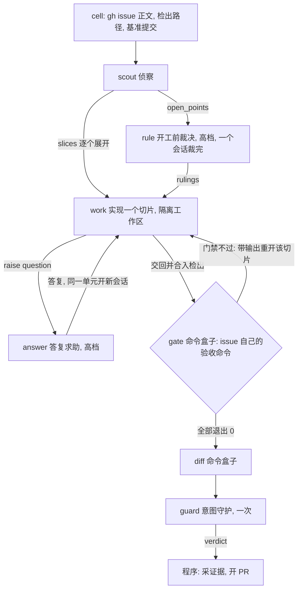

# 低成本模型交付 #320 / #321 / #322 的编排方案

依据：omp-config#323 上的两轮试跑（会话记录、`research/lowcost/runs/`、`research/lowcost/v2/p323/`）、omp-sessions#41 经 `flow` 工具的两遍运行（会话 `01a1e018-287d-7121-860a-e1cbdc0bc915` 和 `01a1e040-4613-7444-9e4e-b1ad731effc3` 的 `flow.jsonl` 和各子会话记录）、自写的确定性探针（`research/lowcost/eval/battery.ts`）、28 个 issue 正文的验收表解析（`research/lowcost/catalog.js` 生成 `catalog.json`）和 25 个 child 的侦察结果（`research/lowcost/scouts/`）。费用是会话记录里的标价。验收行按「本机 / 沙箱」「单条命令 / 散文步骤」的归类来自关键字和单元格形状，个别行可能归错。

## 1. 结论

- 一个 issue 不交给任何单个 agent。流程拆成侦察、开工前裁决、实现切片、答复求助、意图守护、执行验收行这些小任务，每个任务一个新会话；门禁、依赖安装、集成、采证据和开 PR 由程序做；每个任务的交回值由程序展开成后续任务。
- 正确性只由运行时行为判定：门禁是程序在检出里执行的命令，失败时带着输出重开对应的切片。没有审查循环，没有投票。
- 高档模型（Sonnet）只做两件事：开工前一次裁完侦察报出的开放点，以及答复实现者的求助。结束时的意图守护用低成本模型读一次。裁错由最终验收兜底。
- 实现者是 Haiku。SWE-2 免费但慢且有并发限流，只开一个并发位，用在侦察和意图守护上。DeepSeek 本周首选渠道额度用完，没有参加 #41 的运行。
- #41 在最后的代码上从头重跑：四个会话和两个门禁全部一次通过，没有重试和异常，标价 $0.48（其中 SWE-2 的 $0.21 走免费额度），流程用时 9 分 7 秒。此前在旧代码上的那一遍，一次通过的部分是 $0.65，流程自身的两个缺陷另外花掉 $0.33；两个缺陷都已修复（第 2 节）。
- 验收表共 174 行。109 行的 Command 是写死的命令（或引用前一行的命令），由程序经 `ghc ev run` 执行；65 行是散文步骤（「起会话，输入某句话」「按某 issue 第 N 行执行」），三个总体验收 issue 的 24 行全部属于这一类。其中 63 行交给验收行执行者把它变成命令并驱动终端，2 行（Windows 真机、Tern 窗口）由主会话做。执行者在一条本机散文行上读数全对；驱动终端和沙箱的那一半还没有测到，是本方案最大的未知。
- 174 行里 83 行要沙箱。本机 Docker 地址池现在是满的，一行沙箱行都跑不了；不依赖沙箱就能交付的 child 只有 6 个。

## 2. 三次运行的数据

### 第三次：omp-sessions#41 经 `flow` 工具

[omp-sessions#41](https://github.com/oh-my-omp/omp-sessions/issues/41)：1 个切片（`src/routes.ts`），5 行验收全是本机命令。它跑了两遍：先在当时的代码上（暴露并修掉了流程的两个缺陷），再在最后的代码 `85a78aa` 上从头重跑。两遍都是分段运行，每段一次 `run`，盒子分几次加进同一条流程；没有作为一次不间断的 `run` 跑过。

**在 `85a78aa` 上重跑**（三段：侦察；裁决、实现和两个门禁；diff 和守护）：

| 段 | 会话 | 模型（档位设置） | 请求数 | 用时 | 标价 | 结果 |
|---|---|---|---|---|---|---|
| 侦察 | `Flowscout_s1_7c83` | SWE-2（`task:free1`） | 16 | 257 s | $0.140，免费额度 | 1 个切片（文件只有 `src/routes.ts`）、2 个开放点、4 个门禁缺口 |
| 裁决 | `Flowrule_s1_3573` | Sonnet（`task:high`） | 4 | 28 s | $0.124 | 2 条裁决，都是「不立规则」 |
| 实现 | `Flowwork_0_s1_45ac` | Haiku（`task:low`） | 24 | 174 s，含程序装依赖 | $0.150 | 交回 `src/routes.ts`，宿主合成提交 `ff02154`（+60/−14） |
| 门禁 | 程序 | — | — | 数秒 | — | 验收驱动和 `bun run check && bun test` 都是第一次就退出 0 |
| 守护 | `Flowguard_s1_f499` | SWE-2（`task:free1`） | 11 | 92 s | $0.070，免费额度 | `pass`，无违例 |

- 合计标价 $0.48，付费部分 $0.27（Sonnet $0.12、Haiku $0.15）；三段的流程用时是 4 分 17 秒、3 分 18 秒、1 分 32 秒。
- 依赖由程序装：实现会话的工作区里 `node_modules` 是真实目录，会话第一次跑验收驱动就得到读数；合入后检出干净，`node_modules` 没有进提交。
- 模型行为（每个角色一次样本）：侦察没有再把 `CHANGELOG.md` 列进切片，并写明那是发布流程的事；裁决者查了宿主怎样生成 id，两个开放点都判成没有生产者；实现者先在基准上跑了一次验收驱动确认它失败，没有碰 `CHANGELOG.md`，把没看过 README 列进了 `unverified`；守护者没有重跑命令，读了改动、调用点和宿主源码。
- 驱动流程的主会话用的是免费渠道的 nemotron。三段里它都没有按工具的提示结束回合，而是反复查状态和读子会话记录，上下文涨到 77%，每次都要手动打断；流程本身不受影响。

**第一遍（旧代码，四段：侦察；裁决；实现加两个门禁；diff 加守护）**：

| 段 | 会话 | 模型（档位设置） | 请求 / 工具调用 | 用时 | 标价 | 结果 |
|---|---|---|---|---|---|---|
| 侦察 | `Flowscout_s1_32ca` | SWE-2（`task:free1`） | 20 / 35 | 248 s | $0.145，免费额度 | 1 个切片、3 个开放点（1 个标了无生产者）、2 个门禁缺口 |
| 裁决 | `Flowrule_s1_3ff3` | Sonnet（`task:high`） | 4 / 4 | 32 s | $0.271 | 3 条裁决，全是「新规则」 |
| 实现 | `Flowwork_0_s1_aacd` | Haiku（`task:low`） | 21 / 24 | 185 s | $0.136 | 交回 `src/routes.ts`、`CHANGELOG.md`，宿主合成提交 `4f23677` |
| 门禁 | 程序 | — | — | 数秒 | — | 验收驱动 exit 0，第 1–4 行的读数全部符合；`bun run check && bun test` exit 0。两个门禁都是第一次就过 |
| 守护 | `Flowguard_s1_e105` | SWE-2（`task:free1`） | 17 / 21 | 152 s | $0.101，免费额度 | `pass`，无违例 |

- 合计标价 $0.65，付费部分 $0.41（Sonnet $0.27、Haiku $0.14）；流程墙钟约 10 分半。
- 这之前实现段失败过两次，都不是实现的问题：两次里 worker 在自己的工作区跑验收驱动都是 exit 0、`bun test` 67 条全过。
  - 第一次（$0.152，另有一个被取消的重开会话 $0.018）：隔离工作区里没有 `node_modules`，worker 建了一个指向克隆的符号链接；仓库的 `.gitignore` 只忽略目录 `node_modules/`，链接进了提交，宿主合回检出失败。当时的流程把这次交回记成完成，门禁在没有改动的检出上读出基准读数，于是重开了切片。
  - 第二次（$0.164）：流程已改成把合入失败记成 `workspace` 异常并停下；我把 `node_modules` 写进克隆的 `.git/info/exclude`，但隔离工作区看不到克隆的这个文件，链接又进了提交，流程按设计停下。
  - 第三次改成在工作区里 `bun install`（真实目录，被 `.gitignore` 忽略），通过。之后依赖安装改由程序做（盒子的 `prepare` 命令）。
- 这一遍里的模型行为（每个角色一次样本）：
  - SWE-2 侦察：把 `CHANGELOG.md` 列进了切片文件；三次请求之间有 63、33、81 秒的停顿，其余步骤 2–3 秒。
  - Sonnet 裁决：对标了「无生产者」的那个开放点仍然立了新规则，违反裁决者定义里「无生产者不立规则」；另一条裁决要求的去重落在切片文件之外的 `handler.ts` 的行为上，worker 在 `routes.ts` 里实现了它。
  - Haiku 实现：第一次运行里它先读笔记文件、建 todo，自己跑了验收驱动和测试，还另写了一个探针检查三条裁决，其中两次被 `delete-guard` 拒绝带变量的命令后改用字面路径；第三次按任务书先装依赖。第三次它没有照字面执行第三条裁决（「带时间戳的加自定义名的一起算」），理由是那样会和 issue 的结果 4 冲突，并把这一点写进了 `decisions`。
  - SWE-2 守护：没有重跑任何命令；读了改动、调用点和宿主源码；把 worker 对第三条裁决的偏离判为符合 issue；没有指出第三条裁决本身超出了 issue 的范围，也没有提实现者手写了 `CHANGELOG.md` 的条目（issue 正文没有提 changelog；仓库的约定是条目由 lgit 写，手写的会被保留）。

### 第一轮：一个 worker 拿整个 issue，审查者逐条检查，裁决者按需介入

| 克隆 | worker | 轮数 | 审查轮数 | 审查花费 | 裁决花费 | 结局 |
|---|---|---|---|---|---|---|
| low | Haiku $0.21 | 2 | 1（DeepSeek 审） | $0.04 | $0.32 | 通过 |
| free1 | SWE-2 $0.43 | 5 | 4（Haiku 审） | $0.49 | $0.55 | 第 4 轮仍不过 |
| mid | DeepSeek $0.11 | 5 | 3（Haiku 审） | $0.62 | $0.43 | 第 3 轮仍不过 |

- 「代码不得自行决定开放点」这条检查不收敛：每轮审查都能再找出一个新角落，最后两个是没有任何生产者会发出的构造输入。
- 两个裁决者对同一问题（旧形状带 `timedOut`）裁出相反结论。
- 审查找到的三个真缺陷（纯空白答案、多行答案、类型链接漏洞）都能写成运行时用例；探针 5 秒测出全部三个。
- 内置 `task:*` 定义让 SWE-2 和 DeepSeek 各派了一次 mentor 子代理，是编排之外的开销。
- low 那一行只审了一轮、审查者不同、当时也没有那条不收敛的检查，和另两行不可直接比。

### 第二轮（v2）：侦察 → 一次裁决 → 切片实现 → 程序门禁 → 一次签署

三个实现者拿到同一份侦察结果和同一批裁决：

| 实现者 | 轮数 | 求助 | 门禁 | 请求数 | 标价 | 用时 | 探针：明文行为 / 措辞隐含 / 类型变更 |
|---|---|---|---|---|---|---|---|
| Haiku | 1 | 0 | 首次通过 | 16 | $0.12 | 169 s | 19/19、3/3、4/8 |
| SWE-2 | 1 | 0 | 首次通过 | 32 | $0.22（免费额度） | 289 s | 同上 |
| DeepSeek | 1 | 0 | 首次通过 | 48 | $0.05 | 381 s | 同上 |

- 三者产出相同。第一轮的差距来自开放点没先裁、隐含行为没有门禁，不是模型能力。
- 类型变更 8 项只拦住 4 项，因为门禁只要求了 3 种改名：门禁量什么，产出就保证什么。
- DeepSeek 第一次运行列出同级目录并读了别的克隆里现成的答案，被终止后在隔离目录重跑；第一轮它还三次改 `node_modules`。
- #323 整条流程（Haiku 实现）：侦察 $0.04 + 守护者 $0.49（一次裁决、两次签署）+ 实现 $0.12 = $0.65。守护者占四分之三。

### 侦察角色：同一份 #323 合同

| 模型 | 切片 | 两个真实开放点 | 其他开放点 | 门禁缺口 | 标价 |
|---|---|---|---|---|---|
| SWE-2 | 1 个，把被 git 忽略的 `bun.lock` 列进可改文件 | 都找到 | 无 | 5 | $0.22 |
| Haiku | 2 个，其中「刷新 `bun.lock`」无法提交 | 都找到 | 2 个，标了无生产者 | 11 | $0.12 |
| DeepSeek | 1 个，正确 | 都找到 | 1 个，有生产者 | 5 | $0.04 |

DeepSeek 用宿主的表单解析器实际跑了输入来确认生产者。

### 验收行执行者

验收行执行者（DeepSeek）跑了两行：

| 行 | 结果 | 核对 | 标价 |
|---|---|---|---|
| #337 第 5 行（沙箱交互） | 第一步建沙箱失败，按 blocked 交回，没有动别人的网络 | Docker 的 30 个 IPv4 地址池被占满，其中 18 个是无容器的 `cua-t-*` 网络；我重试建网络得到同一个错误 | $0.02 |
| #337 第 9 行（本机散文步骤：照 5 个 issue 正文落 7 个固定脚本，按占位符拼出 8 条命令各跑一次） | 判 fail，1 条 exit 0、7 条 exit 1 | 7 个脚本与我独立抽取的逐字节相同；8 个退出码和输出与我自己跑的一致 | $0.017，22 次请求，87 秒 |

- 第 9 行的检出是 #323 的 PR head 加两个插件的 main，所以只有 #323 的驱动通过，其余 7 个在未实现的基准上失败：这同时证实这些驱动在基准上是红的。它没有重试，也没有为了通过去改命令，并在偏差里指出检出不是缓冲分支的 head。
- 它多做了几次只读排查（`git log`、`grep`），没有改任何文件。
- 驱动终端和沙箱的能力仍然没有测到。

## 3. 流程

程序是 omp-subagent-more 仓库里的 `flow` 工具（`prototype/flow/`，用 `omp -e prototype/flow/host.ts` 加载）；它是试验代码，不随插件发布。一条流程是一组按名字互相引用的盒子：agent 盒子每次点火开一个新会话，命令盒子跑一条 shell 命令。盒子是普通数据，在 eval cell 里定义，可以逐个重写；`gh`、`git` 的结果在 cell 里直接登记成流程的输入。状态是会话目录下一份只追加的 `flow.jsonl`，omp 重启后照原样恢复。

| 盒子 | agent 定义 | 模型设置 | 输入 | 交回值 | 之后 |
|---|---|---|---|---|---|
| `scout` | `flow:scout` | 见第 4 节 | issue 正文 | `slices[]`、`open_points[]`、`gaps[]` | 每个切片变成 `work` 的一个单元；开放点整组交给 `rule` |
| `rule` | `flow:adjudicator` | `task:high` | issue 正文、全部开放点 | `rulings[]`，每条是「合同已定 / 不立规则 / 新规则」之一 | 写进每个 `work` 单元的任务书 |
| `work` | `flow:worker` | `task:low` | issue 正文、一个切片、裁决 | `files[]`、`decisions[]`，或抛出 `question` | 交回的改动由宿主合入检出；`question` 由 `answer` 答复后，同一单元开新会话继续 |
| `answer` | `flow:adjudicator` | `task:high` | issue 正文、求助内容、求助者的交接和笔记文件路径 | `rulings[]` | 只在有人求助时点火 |
| `gate_*` | 命令盒子，`checks: "work"` | — | 检出路径、`work[]` | 命令输出 | 门禁不过时，它检查的那个单元重开成新会话，新会话拿到上一次的交接和命令输出；这是流程自己的回路，不是异常。重开次数受 `work` 的 `bound` 限制，用完才是异常；门禁命令本身跑不起来也是异常 |
| `diff` | 命令盒子 | — | 基准提交、两个门禁 | `git diff` | 交给 `guard` |
| `guard` | `flow:guardian` | 见第 4 节 | issue 正文、diff、门禁输出、`work` 的自主决定、裁决 | `verdict`、`violations[]` | 只读、只跑一次、不重跑任何命令 |

- 盒子的写法、异常和停下后的处理是工具自己的说明（会话里读 `xd://flow/boxes`、`xd://flow/lifecycle`），这里只写这份方案怎样用它。
- 改文件的盒子写 `isolated: true`，只读的写 `false`；`work` 盒子带 `prepare`，写该仓库的依赖安装命令。
- 门禁盒子都写 `checks: "work"`：门禁不过就重开那个切片，这是流程的回路。异常是另一回事：没有写处理办法的异常会停下整条流程，由主会话改盒子、撤回单元或原样重试后再 `run`。
- 一条流程只属于一个 omp 会话。一次等待不超过 5 分钟，所以流程分段运行：先只定义 `scout`，它交回后再定义下一段；已有的结果不受影响。
- 编排单位是「一棵树在一个仓库里的一轮」：该仓库本轮全部 child 的切片在同一个克隆里按顺序实现，提交累积在一个 head 上，证据都采在这个 head，每个 child 的 PR 分支 `<缓冲分支>-c<child>-r<轮次>` 都指向它。这是 `delivering-issues` 对一轮的要求；与它不同的只有一点：一轮不交给一名实现者，集成由程序负责。
- 采证据、开 PR、合入缓冲分支还没有写成盒子，仍由主会话在 cell 里做（见第 12 节）。

## 4. 角色与模型

| 角色 | 定义 | 模型 | 依据 | 并发 |
|---|---|---|---|---|
| 侦察 | `flow:scout` | SWE-2（`task:free1`）；DeepSeek 额度恢复后改回 DeepSeek | #41：切片和开放点可用，4 分钟，免费。#323 的对比里 DeepSeek 切片正确、$0.04、会实测输入来源 | SWE-2 全局 1；DeepSeek 6–9 |
| 开工前裁决、答复求助 | `flow:adjudicator` | Sonnet（`task:high`） | 高档只用于裁决和答复求助 | 每条流程 1 |
| 实现 | `flow:worker` | Haiku（`task:low`） | #323 和 #41 都是门禁首次通过；3 分钟一个切片，$0.12–0.16 | 按仓库数 |
| 意图守护 | `flow:guardian` | SWE-2（`task:free1`） | 你定的档位。与实现者不同模型；#41 上两次，1.5–2.5 分钟、免费、会读调用点和宿主源码。两次都判通过，其中第一次漏掉了超出范围的裁决和手写的 changelog 条目；它还没有拦下过任何东西 | 全局 1 |
| 验收行执行者 | `flow:verifier` | DeepSeek | 规则要求真实会话至少用 mid 档；把散文步骤变成命令、驱动终端的能力都未评测 | 受沙箱数限制 |

- 定义在 `prototype/flow/agents/flow-*.md`，各有自己的 system prompt，不带模型；用哪一档的模型设置写在盒子的 `model` 字段里，所以换档只改盒子。定义里没有 `spawns`，不会再派 mentor。
- SWE-2 同时担任侦察和守护，全局只有一个并发位：多条队列并行时它是瓶颈，#41 上每次占 1.5–4 分钟。
- 裁决是付费部分里最大的一笔（#41 两次：$0.27 对 3 条、$0.12 对 2 条；#323：$0.31 对 8 条）。每条裁决约 $0.03，其余是第一次请求的提示词：缓存是冷的时候写入 47,757 个 token、$0.19；45 分钟后同一个克隆里的第二个裁决会话有 33,020 个 token 读自缓存，只写入 14,473 个、$0.06（缓存有效期 1 小时）。所以裁决会话要连着跑，并且一次裁完整组，不逐点裁。别的仓库的裁决会话能不能读到同一段缓存没有测过：提示词里有各仓库自己的项目规则，前缀可能在那里就不同了。
- 裁决者在 #41 的第一次运行里给无生产者的输入立了规则。定义改成先判「无生产者」再考虑新规则之后重跑了一次：两个开放点都裁成「不立规则」，理由是宿主只生成 UUIDv7 的 id，没有东西会产生那两种输入。改前改后各一次样本，开放点也不是同一批，说明不了是改定义造成的。
- DeepSeek 的首选渠道（opencode-go）本周额度已用完；lgit 也要加 `--model commandcode/deepseek/deepseek-v4.1-flash` 才能提交。

## 5. 门禁与证据

- **门禁是命令盒子**：每条门禁一个盒子，声明它检查哪个 agent 盒子（`checks`）。门禁集合：issue 自己的验收命令；卫生命令；改动文件不超出切片文件的并集；issue 写明「不应残留」的文本；裁决用例。类型链接这类合同约束没有通用门禁：#323 的那个（「把宿主类型里解析器依赖的字段改名，`tsc` 必须失败」）是我写的。
- **证据只有程序跑的那一次**：worker 开发时可以自己跑验收命令，但不算数；它交回、改动合入检出后，门禁盒子在检出里各跑一次，守护者读它们的输出，不重跑。worker 自己那一次是它交回前唯一的反馈：验收驱动跑一次约 1 秒，而带着错误交回要多开一个会话（约 3 分钟、$0.14）。
- **门禁和守护定不了范围**：#41 的两遍运行交回了两份不同的改动，一份实现了三条「新规则」（+142/−13），一份一条也没有（+60/−14），两份都过了同样的两个门禁和守护。门禁只保证 issue 验收表量到的行为；裁决立了什么、立得对不对，现在没有东西在查。
- **裁决用例还没有接进门禁**：#41 的三条裁决只写进了任务书，由守护者对照 diff 检查。把裁决写成「输入 → 期望输出」并变成命令盒子是 v2 试跑里验证过的做法（#323），在 `flow` 工具里还没有做。
- **验收表只执行一次**：在该仓库本轮的 head 上逐行 `ghc ev run`，每行超时不超过 300 秒；单条命令的行由程序执行，散文步骤的行由执行者把每一步经 `ghc ev run` 执行。`ghc ev check` 齐全后开 PR，`ghc ev publish` 发证据包。
- **裁决用例不是验收行**：它们只进门禁，不进证据包。
- **提交**：worker 不提交。它交回时宿主把改动作为一个提交合进检出，提交说明是会话名；切片过门禁后，程序把这次提交用 lgit 重做一遍，生成提交说明和 CHANGELOG 条目。侦察和实现都不碰 `CHANGELOG.md`。

## 6. 规则对编排的约束

来自对 `~/.omp/agent/rules/`、`.omp/rules/`、`.omp/RULES.md` 的调查（`local://rules-omp-interrupts.md`，已对照规则文件和宿主源码核对）：

- 规则会进入子代理。只有写了 `agents: main` 的规则不进（本仓库的 `hard-decisions-go-to-carbon`）。`.omp/RULES.md` 的 Windows 测试机说明会进入每个子代理的提示词。
- 流式拦截规则按文本匹配，每条每会话只触发一次，不看否定句。对编排有影响的几条：
  - `no-e2e-on-low-tier-subagents` 只认 `task:free1` 和 `task:low` 这两个名字，管不到 `flow:*`；「真实会话至少用 mid 档」由程序里的角色分配保证。
  - `evidence-run-five-minute-budget`：每次证据采集不超过 5 分钟，一行一次，不串成长脚本。它也拦主会话对整条流程的一次长等待，所以流程分段运行（第 3 节）。
  - `no-issue-edit-by-task-agent`：拦截所有 `gh issue edit`，主会话也在内。
  - `no-silent-script-blind-wait`、`no-manual-github-polling`：worker 和执行者的提示词里已写明不 `sleep`、不轮询。
  - `todo-item-max-30-min`、`no-todo-block`：worker 首次编辑前必须建 todo（todo 插件会拒绝没有 todo 的编辑），提示词里已写明。todo 的完成动作会提交，而 worker 不提交，所以提示词写明只建不勾。
- 内置 `task:*` 定义的正文在自定义 agent 里不存在，需要的纪律已写进 `flow:*` 的正文；本机是 light 模式，完成判定、拆分检查这些扩展没有加载。
- 用户级规则进入每个子会话的 system prompt：#41 的侦察会话里 system prompt 约 6.2 万字符，含 `<generic-rules>` 和 Windows 测试机说明。裁决会话（Sonnet）在缓存是冷的时候，第一次请求写入缓存 47,757 个 token，占该会话 $0.27 中的 $0.19（缓存热的情况见第 4 节）。
- 用户级的路径规则会在子代理读到匹配路径时整段注入，每个 worker 至少一次，约 10 KB，无法从项目侧关掉。流程把笔记文件放在 `~/.omp/agent/sessions/…` 下，这个路径匹配 `omp-maintenance` 规则，所以每个读笔记的会话都会被注入一次。
- `delete-guard` 拒绝带变量展开的命令：#41 的 worker 写 `bun $P/probe.ts` 被拒两次，改成字面路径后才通过。

## 7. 每个 child 开工前程序做的事

| 步骤 | 做法 | 依据 |
|---|---|---|
| 克隆 | 每棵树每个仓库一个克隆，放在 `/tmp/delivering-issues/<树根>/<仓库名>`，从该仓库的缓冲分支检出本轮分支；omp-config 的克隆目录名必须是 `omp-config` | #336 的验收脚本用 `join(SRC, "omp-config")` 找检出 |
| 刷新宿主依赖 | 按仓库的锁文件选包管理器（bun、npm、pnpm），把 `@oh-my-pi/*` 开发依赖装到当前发布版；锁文件被 git 跟踪的仓库由程序提交这次刷新 | 继承决策 §1。现在的发布版是 18.20.2（`npm view`）。锁文件被跟踪的仓库：omp-ask-more、omp-dispatch、omp-remote-build、omp-playbooks（`bun.lock`），omp-unified-exec（`package-lock.json`），omp-thinking-translator（`pnpm-lock.yaml`，侦察所述） |
| 落夹具 | 验收表引用 35 个 `/tmp` 文件，其中 11 个是验收命令自己从 `/tmp/a7-tool-topics.json` 用 `jq` 派生的，要落的固定文本是 24 个。程序按「说明行点名路径，其后的代码块依次对应」抽取，抽不出的由侦察者照 issue 正文原样写出；两种来源都要过同一个校验：文件全文是 issue 正文的子串，不是就拒收 | 程序规则抽出 24 个里的 16 个，其余 8 个的措辞各不相同；已有的 `/tmp/a4-ask.ts`、`/tmp/c2-adapter.ts` 都通过子串校验 |
| 环境 | 门禁和证据命令在去掉 `OMOMP_MODE` 的环境里执行 | 本会话是 light 模式；#336 的规则脚本在 light 模式下读数为 0（侦察实测） |
| 门禁 | 该 child 验收表里的本机命令行、仓库自己的卫生命令、切片文件范围、issue 写明不应残留的文本、裁决用例 | 沙箱行不进每切片的门禁，只在采证据时跑一次 |
| agent 定义 | 把 `prototype/flow/agents/flow-*.md` 复制到克隆的 `.omp/agents/`，并把 `.omp/` 写进克隆的 `.git/info/exclude` | 定义按项目目录发现；不进提交 |
| 依赖 | 克隆里装一次，供门禁用；`work` 盒子的 `prepare` 写同一条安装命令，供每个隔离工作区用 | 隔离工作区里没有被忽略的文件，也看不到克隆的 `.git/info/exclude`。安装命令产生的东西必须被仓库自己的 `.gitignore` 忽略，否则会进提交（#41 的前两次失败） |
| 隔离设置 | `task.isolation.enabled` 开；`task.isolation.merge` 用 `branch` | 本机就是这样设的；补丁方式没有跑过 |

侦察输出里有三类东西程序不展开成实现任务：不改任何文件的切片（「跑验收」「采证据」）、只改锁文件的切片、被 git 忽略的文件。24 个侦察结果里有 10 个这样的切片；侦察者的定义已补上「切片只在文件内容变化处存在」，用新定义重新侦察 #336，切片从 4 个变成 2 个，原来 3 个开放点（都是执行环境的前提）不再出现。

## 8. 逐 issue 的切片、裁决量和验收行

侦察 25 个 child 共 $1.39（平均 $0.056、约 6 分钟一个，并发 9）。得到 50 个实现切片、82 个开放点（其中 11 个没有生产者）、156 个门禁缺口。侦察者的说法是线索不是事实：我抽查的两条里，#335 第 3 行「按原文无法通过」属实，#335 第 7 行「不改也能过」是它把表格里的 `\|` 读错了。

### 树 [#320](https://github.com/oh-my-omp/omp-config/issues/320)

| issue | 测试形态 | 验收行：程序执行 / 执行者 / 其中要沙箱 | 切片（文件数） | 开放点：有生产者 / 无 | 门禁缺口 | 侦察 |
|---|---|---|---|---|---|---|
| [omp-config#331](https://github.com/oh-my-omp/omp-config/issues/331) | driver | 8 / 1 / 2 | s1-py-sh（7） → s2-js-sh（6） → s3-pty-sh（4） | 0 / 4 | 9 | 391 s，$0.07 |
| [omp-config#323](https://github.com/oh-my-omp/omp-config/issues/323) | driver | 6 / 0 / 0 | answers-shape（1） | 3 / 0 | 5 | 试跑时侦察，$0.04 |
| [omp-config#336](https://github.com/oh-my-omp/omp-config/issues/336) | e2e | 7 / 2 / 2 | template-host-fragments（1） → device-rule-forms（1） | 0 / 0 | 11 | 461 s，$0.08 |
| [omp-config#333](https://github.com/oh-my-omp/omp-config/issues/333) | e2e | 13 / 0 / 12 | S1（1） → S2（3） → S3（1） → S4（1） → S5（1） | 5 / 1 | 9 | 278 s，$0.04 |
| [omp-todo-more#49](https://github.com/oh-my-omp/omp-todo-more/issues/49) | 集成 | 6 / 1 / 1 | host-projection（4） → reader-types（4） | 3 / 0 | 4 | 481 s，$0.08 |
| [omp-ask-more#14](https://github.com/oh-my-omp/omp-ask-more/issues/14) | e2e | 4 / 5 / 3 | host-shaped-results（2） → form-text-readability（2） → delegate-html-form（3） → docs-and-topic（6） → sandbox-e2e（2） | 5 / 0 | 7 | 436 s，$0.07 |
| [omp-dispatch#243](https://github.com/oh-my-omp/omp-dispatch/issues/243) | 集成 | 3 / 2 / 0 | host-adapter-published（3） → mcp-scope-sim（5） | 1 / 3 | 5 | 412 s，$0.06 |
| [omp-config#337](https://github.com/oh-my-omp/omp-config/issues/337)（总体验收） | e2e | 0 / 9 / 6 | 不实现 | — | — | — |

### 树 [#321](https://github.com/oh-my-omp/omp-config/issues/321)

| issue | 测试形态 | 验收行：程序执行 / 执行者 / 其中要沙箱 | 切片（文件数） | 开放点：有生产者 / 无 | 门禁缺口 | 侦察 |
|---|---|---|---|---|---|---|
| [omp-config#330](https://github.com/oh-my-omp/omp-config/issues/330) | 集成 | 1 / 5 / 5 | split-check-steps（4） → isolation-nudge-steps（3） | 3 / 0 | 4 | 366 s，$0.06 |
| [omp-config#329](https://github.com/oh-my-omp/omp-config/issues/329) | e2e | 2 / 2 / 3 | task-item-shape（3） | 4 / 0 | 4 | 337 s，$0.06 |
| [omp-config#327](https://github.com/oh-my-omp/omp-config/issues/327) | 最薄入口 | 1 / 3 / 3 | s1（3） | 2 / 0 | 7 | 396 s，$0.06 |
| [omp-config#332](https://github.com/oh-my-omp/omp-config/issues/332) | 无代码变更 | 0 / 0 / 0 | S1-header-boundary（1） → S2-docs-awk（2） | 5 / 1 | 6 | 325 s，$0.05 |
| [omp-subagent-more#9](https://github.com/oh-my-omp/omp-subagent-more/issues/9) | e2e | 2 / 2 / 2 | S1（2） | 3 / 0 | 7 | 402 s，$0.05 |
| [omp-unified-exec#117](https://github.com/oh-my-omp/omp-unified-exec/issues/117) | driver | 7 / 0 / 0 | s1（3） → s2（4） | 3 / 0 | 7 | 398 s，$0.05 |
| [omp-sessions#41](https://github.com/oh-my-omp/omp-sessions/issues/41) | driver | 5 / 0 / 0 | session-identity（1） | 4 / 0 | 8 | 437 s，$0.06 |
| [pi-bansos#5](https://github.com/mouriya-s-lab/pi-bansos/issues/5) | 集成 | 3 / 1 / 3 | s1（1） → s2（2） | 5 / 0 | 6 | 329 s，$0.03 |
| [omp-config#338](https://github.com/oh-my-omp/omp-config/issues/338)（总体验收） | e2e | 0 / 7 / 6 | 不实现 | — | — | — |

### 树 [#322](https://github.com/oh-my-omp/omp-config/issues/322)

| issue | 测试形态 | 验收行：程序执行 / 执行者 / 其中要沙箱 | 切片（文件数） | 开放点：有生产者 / 无 | 门禁缺口 | 侦察 |
|---|---|---|---|---|---|---|
| [omp-config#328](https://github.com/oh-my-omp/omp-config/issues/328) | 集成 | 8 / 0 / 6 | s1-tool-topics-barrel（2） → s2-ast-top-level-root（3） | 4 / 0 | 4 | 378 s，$0.05 |
| [omp-config#334](https://github.com/oh-my-omp/omp-config/issues/334) | 集成 | 1 / 5 / 5 | cooldown（1） → docs（2） | 3 / 0 | 8 | 344 s，$0.05 |
| [omp-config#325](https://github.com/oh-my-omp/omp-config/issues/325) | 最薄入口 | 2 / 4 / 5 | s1-conflict-report（1） → s2-docs（2） | 1 / 1 | 6 | 298 s，$0.04 |
| [omp-config#326](https://github.com/oh-my-omp/omp-config/issues/326) | 最薄入口 | 1 / 4 / 4 | vibe-gate（2） → describe-vibe-gate（3） | 2 / 0 | 6 | 279 s，$0.04 |
| [omp-config#335](https://github.com/oh-my-omp/omp-config/issues/335) | e2e | 7 / 0 / 5 | s1（3） | 3 / 0 | 4 | 439 s，$0.07 |
| [omp-config#324](https://github.com/oh-my-omp/omp-config/issues/324) | 无代码变更 | 0 / 0 / 0 | S1（1） → S2（2） | 4 / 0 | 5 | 253 s，$0.03 |
| [omp-sessions#40](https://github.com/oh-my-omp/omp-sessions/issues/40) | 集成 | 4 / 1 / 1 | s2-narrow-adapter-imports（1） → s3-readme-coupling（2） | 2 / 0 | 8 | 395 s，$0.05 |
| [omp-remote-build#38](https://github.com/oh-my-omp/omp-remote-build/issues/38) | 集成 | 4 / 1 / 1 | S1（2） | 2 / 0 | 4 | 419 s，$0.06 |
| [omp-thinking-translator#19](https://github.com/oh-my-omp/omp-thinking-translator/issues/19) | driver | 5 / 2 / 2 | deps-latest（2） → host-exports（2） | 2 / 0 | 4 | 425 s，$0.07 |
| [omp-playbooks#44](https://github.com/oh-my-omp/omp-playbooks/issues/44) | driver | 9 / 0 / 0 | add-forms（1） → tests-changelog（2） | 2 / 1 | 8 | 405 s，$0.06 |
| [omp-config#339](https://github.com/oh-my-omp/omp-config/issues/339)（总体验收） | e2e | 0 / 8 / 6 | 不实现 | — | — | — |

- 「切片」列的箭头是执行顺序，括号里是文件数。
- 「开放点」交给裁决者；没有生产者的那部分预期裁成「不立规则」。
- 「门禁缺口」是合同写了但验收表没喂到的行，由裁决者给出用例；需要真实会话才能观察的不进门禁。
- 实现档位不按 issue 区分：v2 试跑里三个模型在同一份裁决和门禁下产出相同，所以每个切片都给 Haiku。

### 多个 issue 改同一个文件

| 文件 | 仓库 | issue | 范围 |
|---|---|---|---|
| `agent/extensions/delete-guard/index.ts` | omp-config | #331（树 320）、#332（树 321） | 跨树 |
| `docs/extensions.md` | omp-config | #331（树 320）、#330（树 321）、#327（树 321）、#332（树 321）、#328（树 322）、#334（树 322）、#325（树 322）、#326（树 322） | 跨树 |
| `docs/extensions.zh-CN.md` | omp-config | #331（树 320）、#330（树 321）、#327（树 321）、#332（树 321）、#328（树 322）、#334（树 322）、#325（树 322）、#326（树 322） | 跨树 |

- 同一棵树里改同一个文件的 child 本来就在同一个克隆里按顺序实现，不会冲突。
- 跨树的重叠在后一棵树合入默认分支前处理：程序把 `origin/main` 合进该树的缓冲分支；有冲突就派一个切片解决，受影响 child 的门禁重跑，总体验收在合并后的提交上采。
- 每个仓库的 `CHANGELOG.md` 每次提交都会被 lgit 改；切片串行提交，所以队列内不冲突。
- 各仓库每天 02:00（GMT+9）自动发布一次，把 `## [Unreleased]` 改成版本段。缓冲分支存活超过一天时，它的条目在合并后可能落进已发布的版本段。本会话就碰到一次：我的提交与 `chore: release 1.1.0` 交错，rebase 没有冲突，条目却进了 `## [1.1.0]`，已另发提交改回。所以开 tree PR 前，程序先把 `origin/main` 合进缓冲分支，再检查该树新增的条目都在 `## [Unreleased]` 下，不在就挪回去。

### 影响编排的逐 issue 事项

| issue | 事项 | 处理 | 来源 |
|---|---|---|---|
| omp-config#335 | 验收第 3 行的 `grep -qF '[FILENAME#TAG] snapshot header'` 少一个反引号，文件里的原句是 ``[FILENAME#TAG]` snapshot header``；这一行按原文任何改动都过不了 | 需要你改验收行（见第 13 节） | 已核实：原模式在文件里匹配 0 次，带反引号匹配 1 次 |
| omp-config#334 | 验收第 4 行要 `sleep 305`，超过「一次证据采集不超过 5 分钟」 | 需要你定（见第 13 节） | 已核实：正文原文 |
| omp-config#336 | 第 1–4 行的脚本要求 `OMOMP_MODE` 未设置、检出目录名为 `omp-config` | 程序按第 7 节准备（去掉 `OMOMP_MODE` 已写进程序） | 侦察实测 |
| omp-config#329 | 第 2、3 行的 `jq` 把宿主自己的 system prompt 也打印出来，而宿主文本里已有被检查的句子，可能不改也过 | 裁决者补「只看 omp-config 那段增量」的用例；是否改验收行等沙箱可用后核实 | 侦察所述，未核实 |
| omp-config#333 | 第 1–11 行 Expect 的后半句「基准提交上 fail」没有任何命令去跑 | 采证据时在基准检出上多跑一次同样的 matrix | 侦察所述 |
| omp-todo-more#49 | 结果 3 说 eval 桥报告 `committed: true`，但宿主拒绝 `details.op` 为 `view` 的结果 | 裁决者裁决；裁不动就列入需要你定的事 | 侦察所述，未核实 |
| omp-config#332 | 结果 1 要求写「判定止于文件头列出的解释器」，但分类器还判了前缀命令（`posix.ts:506-535`） | 同上 | 侦察所述，未核实 |
| omp-config#325 | 第 1 行要求容器里没有 `keybindings.yml`，而沙箱会整份复制本机 `~/.omp/agent` | 本机现在没有这个文件，前提成立；执行者开跑前再查一次 | 已核实：本机无此文件 |
| omp-thinking-translator#19 | 用 pnpm；`CI=true` 时旧锁文件会让第 5 行的 `pnpm install` 直接失败 | 程序在未设置 `CI` 的环境里跑 | 侦察所述 |
| pi-bansos#5 | 仓库没有 tsconfig、scripts 和 CI；owner 是 mouriya-s-lab，本机没有检出 | 卫生门禁只有验收第 4 行的 `bun build`；克隆放 `/tmp` | 侦察所述 |
| omp-config#332、#324 | 无代码变更，没有验收表 | 门禁只有文件范围、卫生命令和裁决者给的 `text` 用例；PR 用无代码变更的要点模板 | issue 正文 |

## 9. 验收行怎么执行

| 行的形状 | 行数 | 执行者 | 做法 |
|---|---|---|---|
| 单条命令，本机 | 81 | 程序 | `ghc ev run <issue> --row N --step … -- <命令>`，命令照抄验收表 |
| 单条命令，沙箱 | 28 | 程序 | 程序起一个 `sandbox hold`，同一 child 的沙箱行共用它，跑完停掉 |
| 散文步骤，child 的行 | 41（沙箱 37、本机 4） | `flow:verifier`，每行一个新会话 | 拿到一行的原文、已起好的沙箱名和夹具路径；把每一步写成命令经 `ghc ev run` 执行，需要 TUI 的用终端驱动；返回每个观察点的读数和判定 |
| 散文步骤，总体验收的行 | 22 | `flow:verifier`，每行一个新会话 | 同上，输入多一份各仓库缓冲分支的 sha |
| Windows 真机行、Tern 窗口行 | 2 | 主会话 | 见下 |

- 执行者返回的读数与 Expect 不符时，程序不让它重试或解释，而是把这一行连同读数变成一个修复切片。
- 执行者只跑、只读，不改检出。它判「通过」的行，证据在 `ghc ev run` 的记录里，程序用 `ghc ev check` 核对齐全。
- 沙箱里的模型必须来自带 `baseUrl` 的 provider（沙箱会删掉其他 provider 的凭据）；按 `omp-maintenance` 规则先用 `futureppo-pool`，30 秒不回就换下一个。
- 同时存在的沙箱数不超过 2，每个沙箱占一个 Docker 地址池。
- 单条命令的沙箱行里有 `bun sandbox/sandbox.ts run <场景>.json <模型>` 这种跑真实会话的命令，耗时取决于模型；超过 300 秒就改派执行者分步执行。

### 三个总体验收 issue

总体验收不走侦察、裁决和实现。它在一棵树的全部 child 合入各仓库缓冲分支之后开始。

| 步骤 | 执行者 | 做什么 |
|---|---|---|
| 取 sha | 程序 | 读树涉及的每个仓库 `origin/tree/oh-my-omp-omp-config-<树根>` 的 head，填进验收表的 `<sha:repo>` |
| 准备检出 | 程序 | 每个仓库在 `/tmp/delivering-issues/<树根>-acc/<仓库名>` 检出该 sha 并安装依赖 |
| 逐行执行 | `flow:verifier` | 每行一个新会话；同一行写明「同一沙箱」的共用程序起好的那个 |
| 汇总 | 程序 | `ghc ev check` 齐全后 `ghc ev publish` 到总体验收 issue；任何一行不过，就在该行「经由」的 child 所在仓库开修复 issue 挂到树下，进入下一轮，不在验收里改代码 |

| 验收 issue | 行数 | `flow:verifier` | 主会话 |
|---|---|---|---|
| #337（树 #320） | 9 | 1、3–9 | 2：Windows 真机 g16pro |
| #338（树 #321） | 7 | 1–7 | 无 |
| #339（树 #322） | 8 | 1–6、8 | 7：本机 Tern 窗口 |

- **#337 第 2 行**在你正在使用的物理机上执行，只经 `omptest` 在 `D:\omp-test` 内操作，跑完 `omptest clean`。只有这一次，而且 `skill://windows` 的安全边界要逐步核对，所以不交给子代理。
- **#339 第 7 行**要在本机 `omp plugin link` 一个检出并在真实 Tern 窗口里操作，会改本机的插件链接。执行前后各记一次 `omp plugin list --json`，跑完恢复原链接。

## 10. 排程

### 队列

一棵树在一个仓库里是一条队列，共 14 条；队列之间并行，队列内串行。

| 树 | 仓库：child |
|---|---|
| #320 | omp-config：#331、#336、#333（#323 已有 PR）；omp-todo-more：#49；omp-ask-more：#14；omp-dispatch：#243 |
| #321 | omp-config：#330、#329、#327、#332；omp-subagent-more：#9；omp-unified-exec：#117；omp-sessions：#41；pi-bansos：#5 |
| #322 | omp-config：#328、#334、#325、#326、#335、#324；omp-sessions：#40；omp-remote-build：#38；omp-thinking-translator：#19；omp-playbooks：#44 |

- 每条队列一个克隆、一个本轮分支、一个 omp 会话和它的一条流程；切片按侦察给的依赖顺序一个接一个实现（`work` 盒子 `limit: 1`），每个切片一个新会话。最长的队列是树 #322 的 omp-config，11 个切片。
- 没有 child 声明 Blocked-by，三棵树同时进行。
- omp-sessions 同时在树 #321 和 #322 里，各有各的缓冲分支和克隆。

### 并发上限

| 资源 | 上限 | 原因 |
|---|---|---|
| Haiku 实现者 | 6 | 起步值；试跑里 Haiku 实现者没有并发过 |
| SWE-2（`task:free1`） | 全局 1 | 并发限流。盒子的 `limit` 只管一条流程之内，跨流程的上限要靠主会话错开各队列用到它的阶段 |
| DeepSeek（侦察、执行者） | 9 | 侦察时用过 9 个并发，没有报错；本周首选渠道额度用完 |
| 高档（`rule`、`answer`） | 每条流程同时 1 个会话 | 高档模型只做裁决和答复求助 |
| 沙箱 | 2 | Docker 地址池 |

### 一棵树的顺序

1. 每个涉及的仓库从默认分支建缓冲分支 `tree/oh-my-omp-omp-config-<树根>`（omp-config 的 #320 那条已建）。
2. 每个 child：裁决者一次裁完开放点和门禁缺口，`call` 用例派人写执行器。这一步各 child 并行，不占克隆。
3. 每条队列：刷新依赖、落夹具，然后逐切片实现、过门禁、lgit 提交。
4. 队列的切片全部通过后，在这个 head 上为队列里每个 child 采证据；齐全的 child 推分支 `<缓冲分支>-c<child>-r<轮次>` 并开 PR，`ghc lint`、`ghc ev publish`。
5. 意图守护者逐 child 读一次；程序把它的结论发成 review 结论，跑 `ghc merge-ready`。
6. 先关掉没通过的 PR，再合入一个通过的（同一 head 的其余 PR 随之显示已合并）。没通过的 child 留到下一轮，在新的缓冲分支提交上继续。
7. 该树全部 child 合入后跑总体验收；通过后每个仓库开 tree PR，`ghc merge-ready <树根> --tree`，先合非树根仓库，最后合 omp-config。

三棵树的 tree PR 依次合入默认分支：#320、#321、#322。后两棵合入前先把 `origin/main` 合进自己的缓冲分支，再跑总体验收。

### 与 `delivering-issues` 不同的地方

| `delivering-issues` | 本方案 | 原因 |
|---|---|---|
| 一轮派一名实现者做完全部 child | 一轮由程序集成，每个切片一名实现者 | 你的要求：不把整个流程交给一个 agent |
| 每个 PR 派一名独立 reviewer | 意图守护者读一次，程序把它的结论发成 review 结论 | 你的要求：不做审查循环；`ghc merge-ready` 在 #349 上接受了这种结论 |
| 设计缺口由编排者裁定并写回 issue 正文 | 高档裁决者裁定，裁决写在 PR 的实现说明里，不改 issue；每棵树合入默认分支前把全部「新规则」类裁决列给你 | `no-issue-edit-by-task-agent` 规则不允许 agent 改 issue |
| 一棵树不拆成多轮 | #323 作为试跑单独成了第 1 轮 | 试跑先于方案 |

## 11. 费用估算

单价来自 #323 和 #41 的实测：侦察 $0.056 一个（DeepSeek，25 个已花）；开工前裁决每条约 $0.03，另加每个会话第一次请求的提示词 $0.06（缓存热）到 $0.19（缓存冷），见第 4 节；实现 $0.14 一个切片（Haiku，五次实测 $0.12–0.16）；意图守护 $0.07–0.10 标价，走 SWE-2 的免费额度。其余是估计。

| 项 | 数量 | 单价 | 小计 |
|---|---|---|---|
| 侦察（已花） | 25 | 实测 | $1.39 |
| 开工前裁决 | 23 个 child（#323、#41 已裁），共约 220 条开放点与门禁缺口 | 每个会话 $0.06–0.19 + 每条 $0.03 | $8.1–11.0 |
| 写用例执行器 | 估 12 个 child 有 `call` 用例 | $0.14，按一个实现切片估 | $1.7 |
| 实现 | 48 个切片 | $0.14 | $6.7 |
| 意图守护 | 23 个 child | $0.07–0.10 标价，免费额度 | $0（标价 $1.6–2.3） |
| 执行散文验收行 | 63 行 | 本机散文行实测 $0.017；沙箱行没有实测，按 $0.10 估 | $6.3 |
| 合计（每步一次通过） |  |  | 约 $24–27 |

- 这张表是推算，不是实测：裁决和守护的单价各只有一两次样本，并且假设每一步一次通过、没有环境失败。#41 的实现段在通过之前因为流程和环境失败了两次，三次合计 $0.47，是一次通过的 3.4 倍；那两个原因修掉之后在 #41 上从头重跑，一次通过；其他仓库会不会有别的环境问题不知道。
- 高档裁决占三到四成。下限假设 23 个裁决会话在一小时内连着跑、只有第一个付冷缓存的价，并且不同仓库的会话共用同一段缓存；后一点没有测过。提示词的大头是每个子会话 6 万多字符的 system prompt，其中带着用户级规则；让裁决会话少带规则、或一个会话裁多个 child 还能再压，两种都没有试过。
- 返工没有计入：门禁不过重开、求助、守护不过、验收行不过、第 2 轮。#323 的 v2 试跑和 #41 的最后一次运行里这些都没有发生，没有可用的比例。
- 主会话（我）的开销不在表里：定义盒子、分段 `run`、停下时的诊断、采证据、开 PR、合并都在主会话里。
- SWE-2 的两项不花钱，但它一次只能做一个，每次 1.5–4 分钟：23 个 child 的侦察加守护串行约需 2.5 小时。

## 12. 没有测过的部分

按风险从高到低：

1. **验收行执行者驱动终端和沙箱**。63 行里 55 行在沙箱里，它在沙箱里一次也没跑成；本机散文行测过一条，读数全对。Docker 地址池腾出来之后第一件事是用 #337 第 5 行重测。
2. **沙箱行**。83 行，一行都没有跑过；沙箱里的模型选择、一行的耗时、两个沙箱并存都没有数据。
3. **裁决用例进门禁，用例执行器由 worker 来写**。#323 的执行器是我写的，`flow` 工具里还没有这一段。校验办法（跑两次读数相同、期望值改错必须失败）只能证明它在比较真实输出，不能证明它调的是合同指的那个入口。
4. **多切片的 child 和一条队列里多个 child 累积在一个 head 上**。#323 和 #41 都只有一个切片，「一个交回值展开成多个单元」只在两个元素的测试流程里跑过；最长的队列有 11 个切片。
5. **采证据、开 PR、合入缓冲分支写成盒子**。现在由主会话在 cell 里做；#349 停在 `merge-ready` 通过，没有合。tree PR 和跨树合并没有做过。
6. **真实 issue 上的求助路径**。`work!question` → 高档答复 → 同一单元开新会话，只在测试流程里用低档模型跑通过；#41 的 worker 没有求助。
7. **SWE-2 限流改派**。流程里没有自动改派：会话失败后由主会话把盒子的 `model` 改成另一档再 `run`。在测试流程里做过一次（失败的会话留下的改动被换了模型的新会话接着用），没有在限流时做过。
8. **其余插件仓库**。omp-config 和 omp-sessions 各做过一个 child；其余 9 个仓库的包管理器、检查命令和提交约定各不相同。
9. **`flow` 工具自身没跑到的路径**：补丁合并方式；从仍然活着的隔离工作区继承；几个切片先后合进同一个检出；一个进程里同时有几条流程；命令超时；从流程外答复求助；在子代理会话里使用；Windows。
10. **宿主升级后要重查的行为**。隔离会话的改动有没有合进检出，流程是从宿主任务结果里的一段文字读出来的，宿主没有给出结构化的字段；宿主改了这段文字，合入失败就会被当成完成。
11. **主会话用低成本模型驱动**。nemotron 不按提示结束回合（第 2 节）；Haiku 驱动过第一遍，没有这个问题。哪些模型能当主会话没有系统测过。

建议的校准顺序：先做其余不需要沙箱的 5 个 child（omp-unified-exec#117、omp-dispatch#243、omp-playbooks#44、omp-config#332、omp-config#324），其中 #117、#243、#44 各有两个切片，覆盖上面的第 3、4、8 项；沙箱可用后先做一个沙箱行多的小 child（omp-config#329：1 个切片、3 行沙箱行），再放开其余。

## 13. 需要你决定的事

| 事 | 现状 | 不决定的后果 |
|---|---|---|
| Docker 地址池 | 30 个 IPv4 池全占，其中 18 个是 11 月 13 日建的无容器 `cua-t-*` 网络（带 `ai.cua.*` 标签），不是本会话建的，我没有动 | 83 行沙箱行跑不了：18 个 child 和 3 个总体验收都拿不到齐全的证据 |
| omp-config#335 验收第 3 行 | 模式少一个反引号，按原文过不了；建议改成 ``grep -qF '[FILENAME#TAG]` snapshot header'`` | #335 的证据补不齐，开不了 PR |
| omp-config#334 验收第 4 行 | `sleep 305` 超过单次证据采集 5 分钟的规则；建议允许这一行在一个终端会话里跑，用 monitor 等它结束 | 这一行采不了证据，#334 开不了 PR |
| 裁决的归宿 | 默认做法：不改 issue，裁决写进 PR 实现说明，合入默认分支前把「新规则」类裁决逐条列给你。#323 现有三条：纯空白答案算未作答；多行答案折成一行；同名同题的答案不去重。omp-sessions#41 重跑的两条裁决都是「不立规则」，对应的改动在克隆的分支 `flow-41-r2`。第一遍立过三条新规则（同一 sid 同一天时日期目录只列一次并打开带时间戳的那份；表头 id 含 URL 写不出的字符时该文件不列出；前缀查找时同一文件的符号链接别名只算一个），对应的改动在分支 `flow-41-r1`。两个分支都已推送到 omp-sessions 仓库，没有开 PR；用哪一个开 PR 还没有定 | 无，按默认做法进行 |
| `~/.omp/agent/config.yml` 第 66 行的 `command-ode` | 是 `commandcode` 的笔误，DeepSeek 的备用渠道因此失效；本会话用临时覆盖绕过，没有改文件 | 新会话里 DeepSeek 在首选渠道额度用完时直接失败 |
